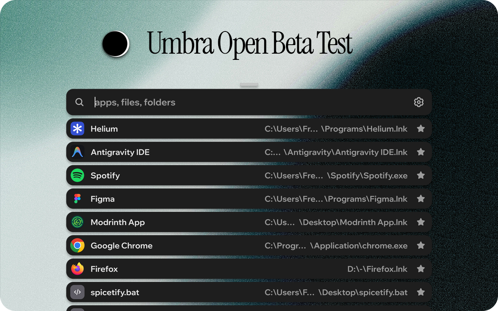
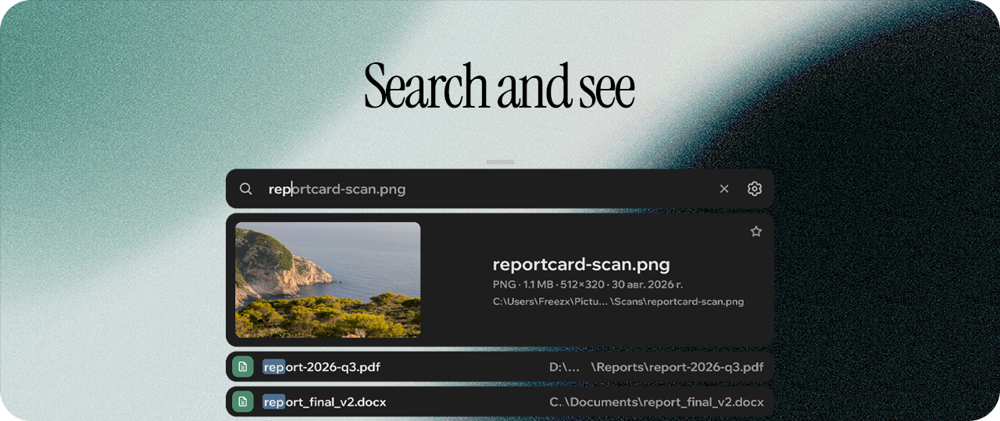
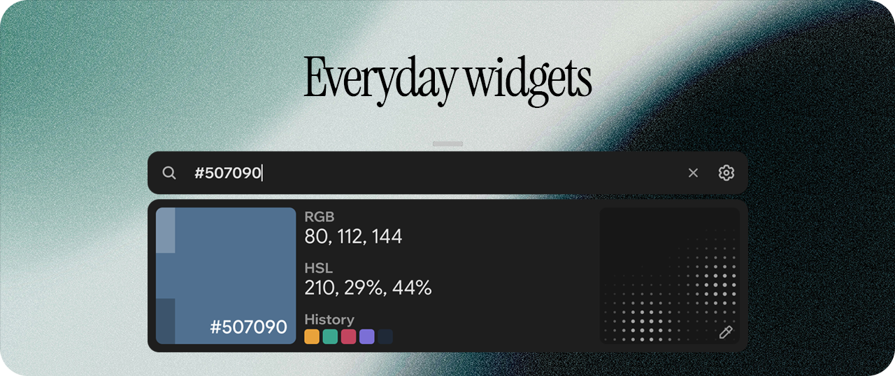
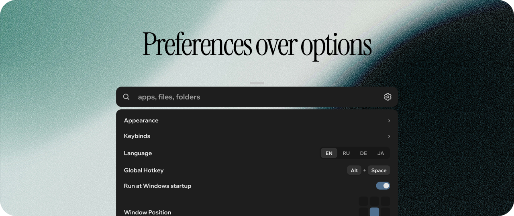
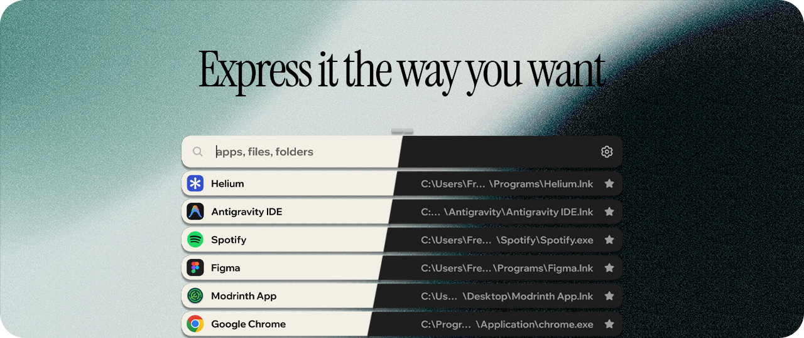

#  Umbra

A minimalist, highly customizable search launcher for Windows, built with Rust and Tauri. Press `Alt+Space`, type, press `Enter`. Written in Rust, it takes next to no CPU while the window is hidden, and the installer is 3 MB.

Umbra is in **open beta**. Something broken or missing? [Open an issue](https://github.com/spectrvm1337/Umbra/issues): bug reports and ideas are exactly what this stage is for.

## Search and see

Find applications, files and folders across your system as you type, ranked by how well the name matches and by what you open most. A program is found by its file name too (`chrome` finds Google Chrome before `chrome_proxy.exe`), and a favourite that matches comes first.

Hold `Shift+Space` to preview the selected result. Drag a result into another application to hand it the file.

Umbra keeps its own index: the Start Menu, installed programs, and the files and folders on your drives. It is built at the first start, kept up to date as files change, and stored in `%APPDATA%\.Umbra-config`. Windows, Program Files, `node_modules`, `.git` and similar folders are skipped; AppData and hidden folders are two switches in Settings, a drive can be turned off from the search box, and the list of skipped folder names is `index_excludes` in `config.json`.

## Everyday widgets

Type, and the answer is already there:

- **Calculator**: `(2+3)*4`, `200+10%`
- **Currency converter**: `100 usd to eur`, with a rate chart and one-click alternatives
- **Color picker**: `#507090` or `!picker`, or pick any color on the screen; values in RGB and HSL, with history
- **Power commands**: `shutdown`, `restart`, `sleep`
- **Process killing**: `kill spot` finds Spotify, and nothing dies until you click
- **Web search**: `!g`, `!yt`, `!gh`, `!wiki` and more; type `!help` for the list

Pin items as a list or a dock, optionally folded away until you need them.

## Preferences over options

Few settings, each one meant: language (English, Russian, German, Japanese), the global hotkey, start with Windows, where the window appears on the screen. Every key is rebindable, and every kind of motion (fade, move, size, color) can be switched off on its own.

## Express it the way you want

Themes, colors, blur, fonts and animations, down to custom CSS ([THEMES.md](THEMES.md)). The cards are blurred over whatever is behind the window, with rounded or squircle corners, by [Haze](https://github.com/spectrvm1337/Haze-blur), and the drag bar and the favorites arrow take their color from the wallpaper. A theme is a file in `%APPDATA%\.Umbra-config\themes`.

## Keyboard shortcuts

| Key | Action |
| --- | --- |
| `Alt+Space` | Show or hide Umbra (changeable) |
| `Tab` | Complete the suggestion |
| `Ctrl+1` … `Ctrl+9` | Open the result with that number |
| `Shift+Space` (hold) | Preview the selected result |
| `D:\ query` | Search one drive only |

Every key can be rebound in Settings → Keybinds. The hotkey works over borderless and windowed full-screen games. Exclusive full-screen cannot show anything on top of it, in Umbra or any other launcher.

## Installation

Windows 10 or 11. Umbra's window is a WebView2 page: it is part of Windows 11 and current Windows 10, and the installer fetches it if it is missing.

1. Open the [Releases](https://github.com/spectrvm1337/Umbra/releases) page.
2. Download the installer (`Umbra_<version>_x64-setup.exe`) or the portable build (`Umbra_<version>_x64-portable.exe`).
3. Run it and press `Alt+Space` to summon the search window.

The **installer** puts Umbra in your user folder, adds it to Windows' list of apps, and can start with Windows. The **portable** build is the single `.exe`: put it anywhere, and it updates itself in place.

Updates: **Settings → Check for updates**.

### Windows says "Windows protected your PC"

Umbra's builds are not signed with a paid certificate yet, so SmartScreen (and some antivirus programs) warns about any new `.exe`. Click **More info → Run anyway**. The source is in this repository, and releases are built from it.

### Uninstall

Installed copy: **Settings → Apps**, then Umbra, or `uninstall.exe` next to it. Portable copy: delete the `.exe`. Your settings, index and themes stay in `%APPDATA%\.Umbra-config`; delete that folder to remove them too. If Umbra was set to start with Windows, turn that off in its Settings first.

## Privacy

Everything stays on your machine: the index, your searches, what you open. There is no telemetry and no account. Umbra reaches the network for three things only: currency rates (cdn.jsdelivr.net, with a fallback to currency-api.pages.dev), the check for updates when you click it (api.github.com), and the icon of a website when you type its address (fetched from that site itself).

## Development

Building from source, tests and project layout are in [CONTRIBUTING.md](CONTRIBUTING.md).

## License

Available under the [MIT License](LICENSE).
